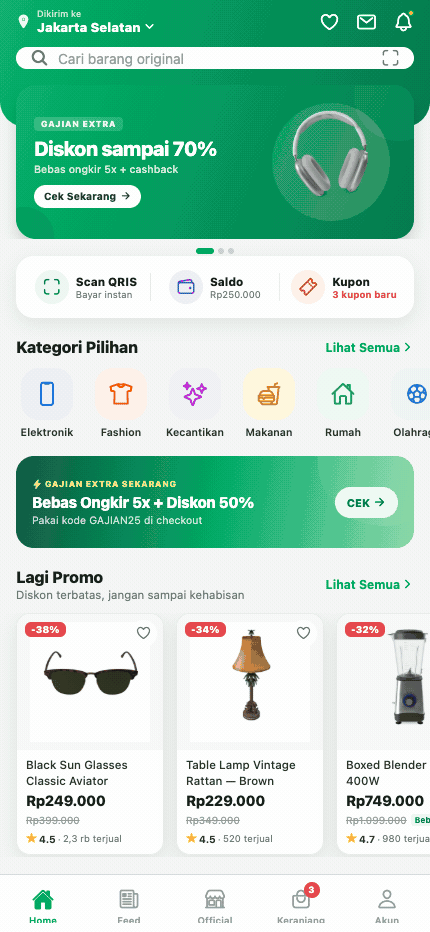
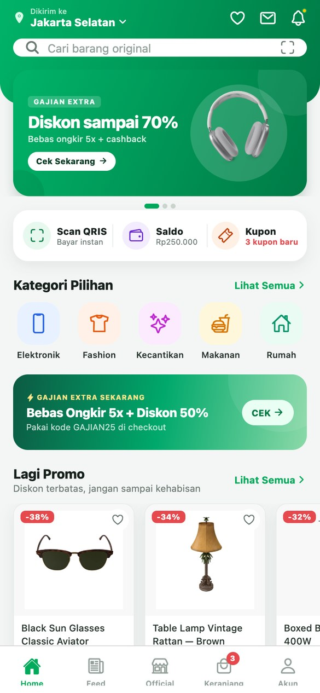
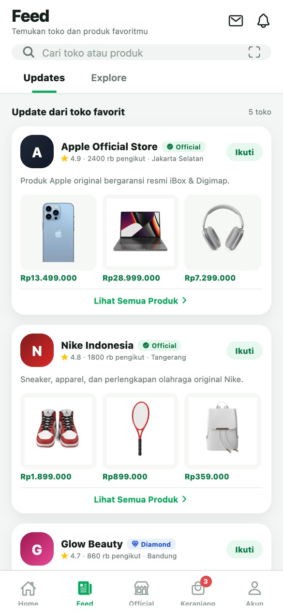
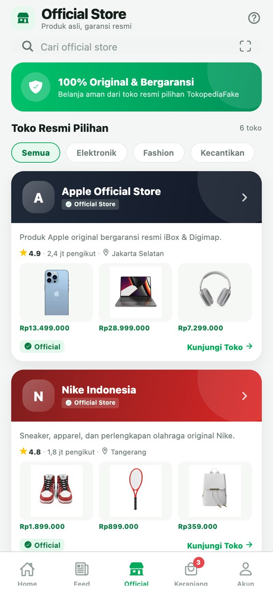
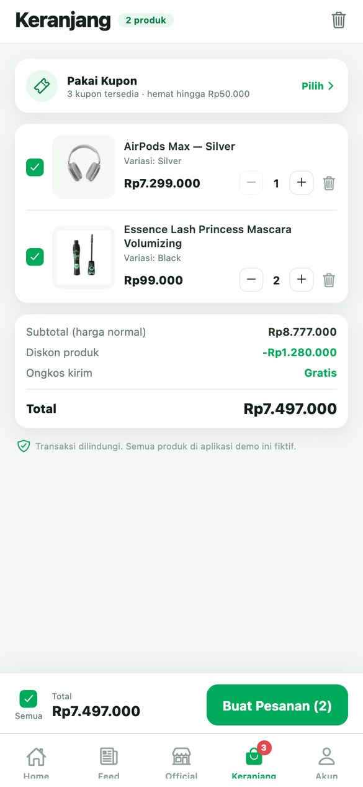
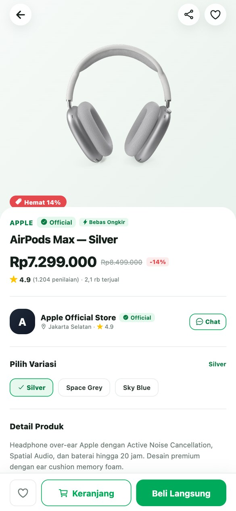
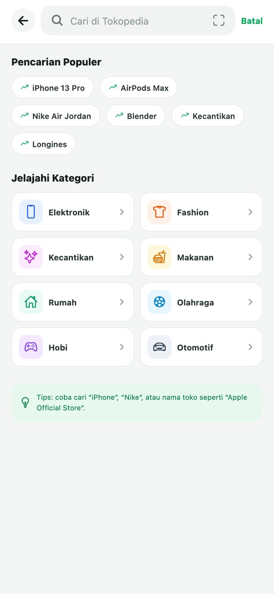
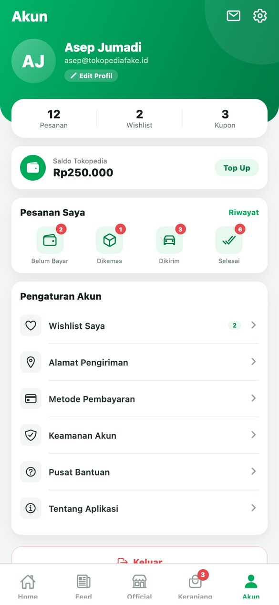
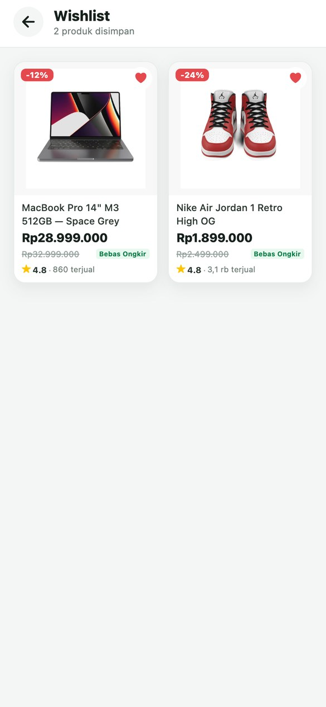

<p align="center">
  
</p>

<h1 align="center">TokopediaFake</h1>

<p align="center">
  <strong>Clone UI Tokopedia untuk latihan — dibangun ulang dengan Expo SDK 58, React Native 0.88, dan Expo Router.</strong>
  <br />
  Expo SDK 58 · React Native 0.88.1 · React 19.3 · TypeScript
</p>

<p align="center">
  <a href="demo/topodiafake.gif"></a>
</p>

<p align="center">
  <sub>Demo alur utama: Home → Detail Produk → Tambah ke Keranjang → Checkout → Pencarian.</sub>
</p>

---

Aplikasi marketplace fiktif yang mengadaptasi tampilan Tokopedia: banner promo, kategori, feed toko, official store, detail produk, keranjang, wishlist, pencarian, dan halaman akun. Semua data dan toko di aplikasi ini fiktif.

Proyek ini adalah hasil migrasi dari React Native CLI lama (0.79 + React Navigation v4 + puluhan library deprecated) ke **Expo terbaru dengan Expo Router**, tanpa membuat folder `android/` atau `ios/` secara manual. Semua kode lama ditulis ulang dengan function components, hooks, dan TypeScript.

## Screenshots

GIF di atas adalah showcase default aplikasi (direkam dari versi web). Screenshot statis tiap layar:

| Home | Feed | Official Store | Keranjang |
| :---: | :---: | :---: | :---: |
| <a href="demo/home.jpg"></a> | <a href="demo/feed.jpg"></a> | <a href="demo/official.jpg"></a> | <a href="demo/cart.jpg"></a> |

| Detail Produk | Search | Akun | Wishlist |
| :---: | :---: | :---: | :---: |
| <a href="demo/product.jpg"></a> | <a href="demo/search.jpg"></a> | <a href="demo/account.jpg"></a> | <a href="demo/wishlist.jpg"></a> |

## Fitur

- **5 tab utama** — Home, Feed, Official Store, Keranjang, Akun (Expo Router JS tabs).
- **Home** — header gradient, pencarian, carousel banner auto-play, quick actions (Scan QRIS / Saldo / Kupon), kategori, promo banner, skeleton loading, pull-to-refresh, dan grid rekomendasi.
- **Feed** — tab Updates & Explore, kartu toko dengan tombol follow, preview produk, dan grid produk.
- **Official Store** — filter kategori, kartu storefront dengan banner gradient dan badge Official/Diamond/Silver.
- **Detail produk** — galeri, harga/diskon, rating, toko, pilihan varian, wishlist, tambah ke keranjang, dan beli langsung.
- **Pencarian** — live search ke nama produk, merek, kategori, dan toko; pencarian populer; filter kategori.
- **Keranjang** — pilih produk, atur jumlah, ringkasan harga yang konsisten (subtotal − diskon = total), modal konfirmasi checkout, dan empty state.
- **Wishlist & Akun** — simpan/hapus produk, statistik akun, saldo, shortcut pesanan, dan menu pengaturan.
- **UX** — toast feedback, haptic feedback (native), skeleton shimmer, safe area, dan layout responsif (frame ponsel di web).

## Tech stack

| Bagian | Versi / library |
| --- | --- |
| Framework | Expo SDK **58** (`expo@58.0.26`) |
| React Native | **0.88.1** (New Architecture) |
| React | **19.3.0** |
| Routing | Expo Router **58** (`expo-router/js-tabs`) |
| Bahasa | TypeScript **6.0.3** |
| Gambar | `expo-image` |
| Gradient | `expo-linear-gradient` |
| Ikon | `@expo/vector-icons` (Ionicons) |
| Haptics | `expo-haptics` |
| State | React Context (`ShopProvider`) |
| Build | EAS Build / `expo run:*` (CNG — tanpa folder native manual) |

## Menjalankan

Butuh **Node.js ≥ 22.13** (sesuai minimum Expo SDK 58) dan npm.

```bash
npm install
npx expo start
```

Lalu:

- tekan `w` untuk web,
- tekan `i` / `a` untuk simulator/emulator,
- atau scan QR dengan **Expo Go** (SDK 58) di perangkat.

Semua library yang dipakai didukung Expo Go, jadi tidak perlu development build untuk mencoba aplikasi ini.

### Build native

Folder `ios/` dan `android/` tidak disimpan di repo. Expo memakai **Continuous Native Generation (CNG)**, jadi folder native dibuat saat dibutuhkan:

```bash
npx expo run:ios      # generate ios/ + build lokal (butuh Xcode)
npx expo run:android  # generate android/ + build lokal (butuh Android Studio)
```

Untuk build cloud:

```bash
npx eas-cli@latest build   # konfigurasi EAS akan dipandu saat pertama kali
```

## Scripts

| Perintah | Fungsi |
| --- | --- |
| `npm start` | Jalankan Expo dev server |
| `npm run ios` / `npm run android` | Buka di simulator/emulator |
| `npm run web` | Buka versi web |
| `npm run typecheck` | TypeScript `tsc --noEmit` |
| `npm run lint` | ESLint (flat config `eslint-config-expo`) |
| `npm run doctor` | Cek kesehatan proyek dengan `expo-doctor` |
| `npm run export:web` | Export web statis ke `dist/` |

## Struktur proyek

```text
.
├── app.json                  # konfigurasi Expo (icon, splash, plugin, scheme)
├── assets/
│   └── images/               # icon aplikasi + foto produk lokal
├── demo/                     # GIF showcase + screenshot untuk README
├── src/
│   ├── app/                  # route Expo Router
│   │   ├── (tabs)/           # Home, Feed, Official, Cart, Account
│   │   ├── product/[id].tsx  # detail produk
│   │   ├── search.tsx
│   │   ├── wishlist.tsx
│   │   └── +not-found.tsx
│   ├── components/           # komponen UI reusable
│   ├── data/catalog.ts       # produk, toko, banner, kategori
│   ├── store/shop.tsx        # state keranjang + wishlist
│   ├── utils/format.ts       # Rupiah, diskon, haptics
│   └── theme.ts              # design tokens
├── eslint.config.js
├── package.json
└── tsconfig.json
```

## Migrasi: sebelum → sesudah

| Sebelum (React Native CLI) | Sesudah (Expo SDK 58) |
| --- | --- |
| React Native 0.79 + `react-native run-*` | Expo SDK 58 + RN 0.88.1, `npx expo start` |
| React Navigation v4 (`createAppContainer`, `createMaterialBottomTabNavigator`) | Expo Router 58 + `expo-router/js-tabs` |
| `react-native-snap-carousel` (deprecated) | `FlatList` paging + auto-play + dots |
| `react-native-linear-gradient` | `expo-linear-gradient` |
| `react-native-radial-gradient` (tidak terpakai) | dihapus |
| `react-native-super-grid` | `FlatList` 2 kolom / flex grid |
| `react-native-shimmer` | skeleton `Animated` pulse |
| `react-native-vector-icons` + font manual | `@expo/vector-icons` |
| `react-native-paper` (tidak terpakai) | dihapus |
| Class components, JavaScript | Function components, hooks, TypeScript strict |
| Gambar produk dari URL Tokopedia 2019 | Aset lokal (`assets/images/products`) — tidak ada broken image |
| Layar placeholder "index" | Keranjang, Akun, Search, Wishlist, Detail Produk yang berfungsi |

## Data & aset

- Semua produk, toko, harga, rating, dan promo adalah **data fiktif** untuk demo UI.
- Foto produk diambil dari dataset demo publik [DummyJSON](https://dummyjson.com/) dan disimpan lokal di `assets/images/products/` agar aplikasi tetap tampil tanpa koneksi ke CDN.
- Keranjang dan wishlist disimpan di memori (Context), sehingga kembali ke data awal saat aplikasi di-reload. Tidak ada backend.

## Verifikasi

Proyek ini sudah dicek dengan:

```bash
npx tsc --noEmit          # lolos
npx eslint .              # 0 masalah
npx expo-doctor           # 20/20 checks passed
npx expo export -p web    # bundle web sukses
npx expo export -p ios     # Hermes bundle sukses
npx expo export -p android # Hermes bundle sukses
```

Alur utama juga diuji end-to-end di browser (Puppeteer + Chrome): navigasi tab, pindah tab Feed, pencarian "nike", buka detail produk, tambah ke keranjang, checkout, keranjang kosong setelah checkout, buka wishlist dari Akun, dan hapus item wishlist — tanpa error console.

---

Dibuat untuk latihan UI. Tokopedia adalah merek dagang pemiliknya; proyek ini tidak berafiliasi dengan Tokopedia.
